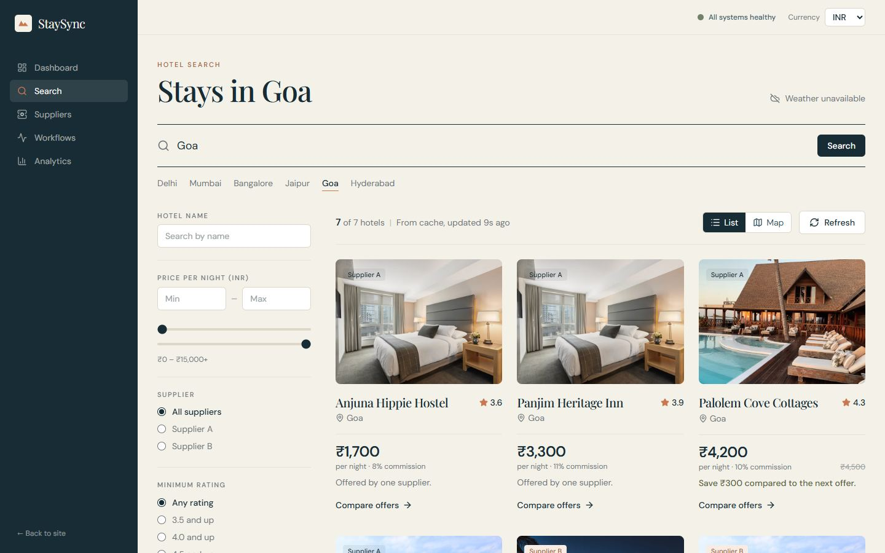
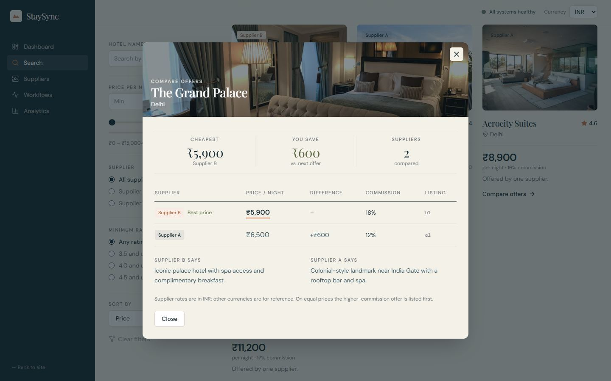
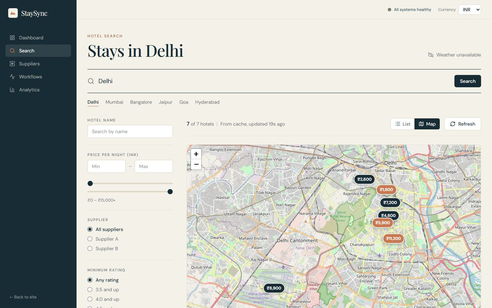
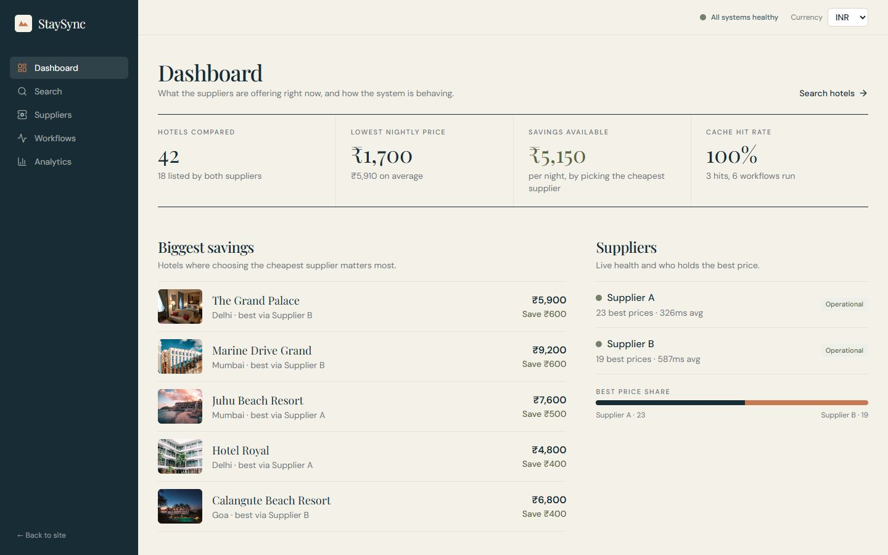
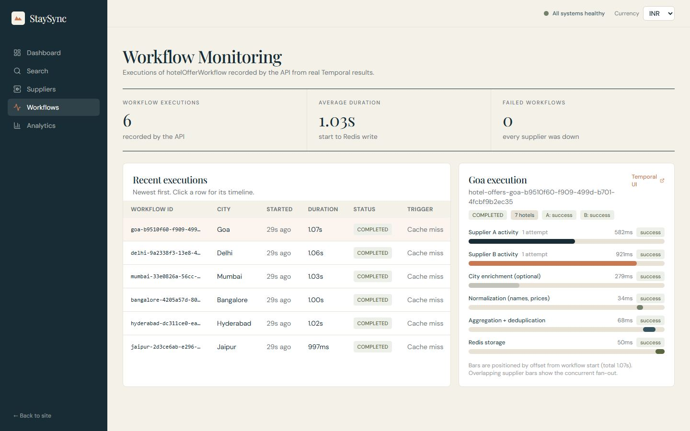
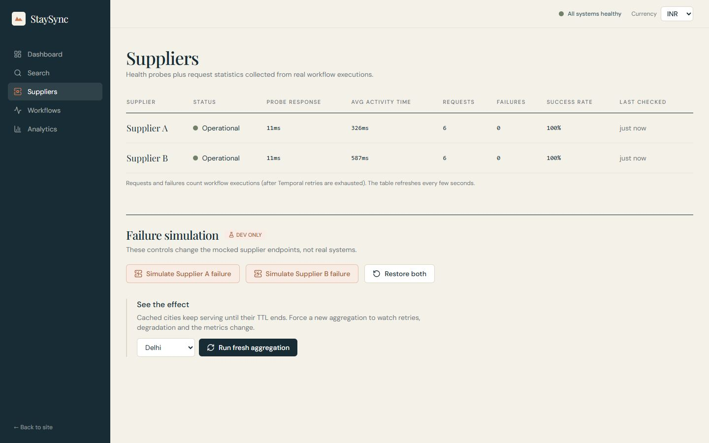
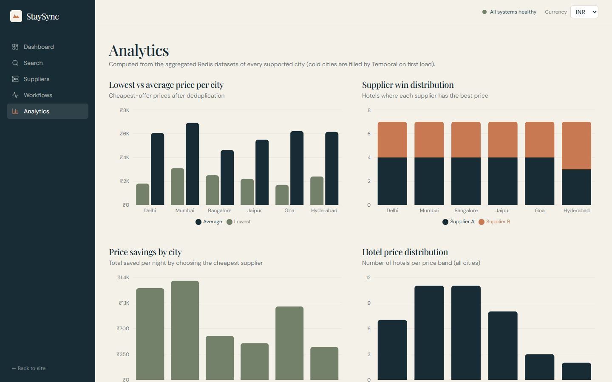
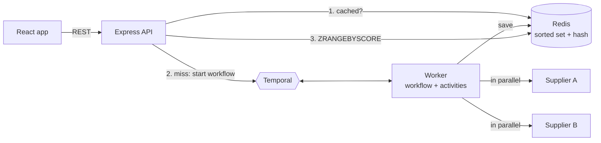

<div align="center">

# StaySync

**Find the stay. Not just the price.**

A hotel offer orchestrator: it queries two suppliers in parallel with a Temporal workflow, keeps the cheapest offer for every hotel, caches the result in Redis, and shows it all in a React dashboard.

     


</div>

---

## Contents

[Screenshots](#screenshots) · [What it does](#what-it-does) · [How it works](#how-it-works) · [Quick start](#quick-start) · [Deploy](#deploy-vercel--render) · [Configuration](#configuration) · [API](#api) · [Deep dives](#deep-dives) · [Testing](#testing) · [Project layout](#project-layout) · [Limitations](#limitations)

## Screenshots

| | |
| --- | --- |
| <br>**Hotel search**: filters, sorting, price slider | <br>**Compare offers**: every supplier, cheapest marked |
| <br>**Map view** (Leaflet + OpenStreetMap) | <br>**Dashboard**: savings, supplier health, workflow activity |
| <br>**Workflow timeline**: parallel supplier calls, aggregation, Redis write | <br>**Supplier monitoring** with dev-only failure simulation |

<details>
<summary>More: destinations and analytics</summary>




</details>

## What it does

- **Cheapest offer per hotel.** Both suppliers list overlapping hotels with different prices and commissions. StaySync groups them by a normalised name, keeps the lowest valid price, and remembers every competing offer, so it can say *"Save ₹600 compared to the next offer."*
- **Temporal orchestration.** One workflow fetches Supplier A and B concurrently, with timeouts and retries, then normalises, deduplicates and stores the result. Each step is a separate activity.
- **Redis does the filtering.** Hotels sit in a sorted set scored by price, so `minPrice` / `maxPrice` are answered by `ZRANGEBYSCORE` inside Redis, not by filtering an array in Node.
- **Survives supplier failures.** One supplier down means partial results flagged `degraded`; both down means a clear `502`.
- **A real product UI.** Landing page, search with list/map views, offer comparison, supplier and workflow monitoring, analytics. Everything is wired to the live API.
- **Optional extras with graceful fallbacks.** Weather (OpenWeather), city coordinates (Geoapify), currency display (Frankfurter). Missing keys never break search.

## How it works



1. A search request is validated, then `hotels:<city>` is checked in Redis.
2. **Hit:** serve from cache (`X-Cache: HIT`). **Miss or `refresh=true`:** the API starts `hotelOfferWorkflow` with a unique ID and waits for it. Simultaneous misses for the same city share one workflow.
3. The worker runs: `fetchSupplierA` ‖ `fetchSupplierB` ‖ `enrichCity` → `normalizeOffers` → `aggregateOffers` → `saveToRedis`.
4. The API reads the price range from Redis, applies the remaining filters and sorting, and responds.

## Quick start

### Option A: Docker (everything in one command)

```bash
cp .env.example .env
docker compose up --build
```

| Service | URL |
| --- | --- |
| App | http://localhost:3000 |
| API | http://localhost:4000 (`/health`) |
| Temporal UI | http://localhost:8080 |

> The compose file was written carefully but **has not been run on the authoring machine** (no Docker there). If something fails on your first run, the logs will say which service.

### Option B: local development

You need Node 20+ and a Redis server (`docker run --rm -p 6379:6379 redis:7-alpine` is the quickest).

```bash
npm install

npm run dev:temporal   # local Temporal dev server on :7233 (no Docker needed)
npm run dev:backend    # API + mock suppliers on :4000
npm run dev:worker     # Temporal worker
npm run dev:frontend   # React app on :5173
```

Run each in its own terminal. Defaults point at `localhost`, so no backend `.env` is required. For the frontend, optionally copy `apps/frontend/.env.example` to `apps/frontend/.env`.

## Deploy: Vercel + Render

The frontend is static and goes to **Vercel**. The whole backend goes to **one Render web service** plus a Redis instance. In this mode the service runs the API, the mock suppliers, a real Temporal dev server and the Temporal worker inside a single process (`EMBEDDED_TEMPORAL=true`), so there is no separate worker and no Temporal account to create.

1. Push the repo to GitHub.
2. **Render, Redis:** *New → Key Value* (free plan, same region as the web service). Copy its **Internal** URL.
3. **Render, web service:** *New → Web Service*, pick the repo, runtime **Node**, root directory **empty**.
   - Build command: `npm install && npm run build` (Render's default; builds the backend)
   - Start command: `npm start` (Render's default)
   - Health check path: `/healthz`
   - Environment: `NODE_VERSION=22`, `NODE_ENV=production`, `EMBEDDED_TEMPORAL=true`, `REDIS_URL=<the Internal URL>`
   - Or use *New → Blueprint*, which reads [`render.yaml`](render.yaml) and sets all of this up.
4. **Vercel:** import the repo (uses [`vercel.json`](vercel.json)) and set `VITE_API_BASE_URL` to the Render URL, without a trailing slash.
5. Optional: set `CORS_ORIGIN` on Render to your Vercel URL (it defaults to allowing any origin).
6. Check `https://<api>/health` (all services healthy), then open the Vercel site.

Notes:

- The first start downloads the Temporal server binary, so it takes a minute or two. `/health` reports Temporal as unhealthy until it is up, while `/healthz` always answers, which is why Render uses it.
- Memory: Temporal plus the API use roughly 350–400 MB, so a 512 MB instance works but has little headroom. Use a bigger instance if you see out-of-memory restarts.
- Free instances sleep when idle; the first request afterwards waits for a cold start, including re-downloading the Temporal binary.
- Embedded Temporal keeps workflow **history in memory** (reset on restart). Hotel data is in Redis and unaffected. For durable history use Temporal Cloud: leave `EMBEDDED_TEMPORAL` off and set `RUN_WORKER=true`, `TEMPORAL_ADDRESS`, `TEMPORAL_NAMESPACE`, `TEMPORAL_TLS=true` and `TEMPORAL_API_KEY` (untested against Temporal Cloud).
- Set `ENABLE_DEV_ENDPOINTS=true` if you want the supplier-failure simulation buttons on a hosted demo.
- A single VPS also works: run `docker compose up -d --build` behind a reverse proxy, without exposing ports 6379, 7233 or 8080.

## Configuration

Complete list in [`.env.example`](.env.example). The ones you will touch most:

| Variable | Default | Purpose |
| --- | --- | --- |
| `REDIS_URL` | `redis://localhost:6379` | Redis connection |
| `CACHE_TTL_SECONDS` | `300` | How long aggregated results stay cached (degraded results use `DEGRADED_CACHE_TTL_SECONDS`, 30) |
| `TEMPORAL_ADDRESS` · `TEMPORAL_NAMESPACE` · `TEMPORAL_TASK_QUEUE` | `localhost:7233` · `default` · `hotel-offers` | Temporal connection |
| `TEMPORAL_TLS` · `TEMPORAL_API_KEY` | `false` · empty | For Temporal Cloud or a secured cluster |
| `EMBEDDED_TEMPORAL` · `RUN_WORKER` | `false` · `false` | Run Temporal + the worker (or just the worker) inside the API process |
| `SUPPLIER_A_URL` · `SUPPLIER_B_URL` | this process (`/supplierA`, `/supplierB`) | Set only to point at external suppliers |
| `SUPPLIER_TIMEOUT_MS` · `SUPPLIER_RETRY_*` | `4000` · `500ms, ×2, 3 attempts` | Timeout and retry policy |
| `ENABLE_DEV_ENDPOINTS` | `true` outside production | Supplier failure simulation endpoints |
| `CORS_ORIGIN` | `*` | Allowed browser origins (comma-separated) |
| `OPENWEATHER_API_KEY` · `GEOAPIFY_API_KEY` | empty | Optional integrations |
| `VITE_API_BASE_URL` | `http://localhost:4000` | Frontend → API (baked in at build time) |

## API

Prices are **INR per night**. Errors share one shape: `{ "error": { "code", "message" }, "meta"? }`.

### `GET /api/hotels`

| Parameter | Notes |
| --- | --- |
| `city` *(required)* | Case-insensitive. Supported: delhi, mumbai, bangalore, jaipur, goa, hyderabad (others return an empty list) |
| `minPrice`, `maxPrice` | Inclusive; either or both. `400` if invalid or `minPrice > maxPrice` |
| `sortBy` | `price` (default), `rating`, `commission` |
| `sortOrder` | `asc` (default), `desc` |
| `supplier` | `Supplier A` or `Supplier B` (the winning supplier) |
| `minRating`, `q` | Minimum rating; hotel-name search |
| `refresh=true` | Bypass the cache and re-run the workflow |

Response headers: `X-Cache: HIT|MISS`, `X-Workflow-Id`.

```jsonc
// GET /api/hotels?city=delhi&minPrice=5000&maxPrice=6500
{
  "data": [{
    "hotelId": "b1", "name": "The Grand Palace", "city": "delhi",
    "price": 5900, "supplier": "Supplier B", "commissionPct": 18, "rating": 4.5,
    "latitude": 28.6139, "longitude": 77.209,
    "originalPrice": 6500, "savings": 600, "competingOffers": 2
  }],
  "meta": {
    "city": "delhi", "totalHotels": 7, "filteredHotels": 3,
    "minPrice": 5000, "maxPrice": 6500, "cache": "HIT", "workflowId": "hotel-offers-delhi-…",
    "degraded": false, "supplierStatus": { "supplierA": "success", "supplierB": "success" }
  }
}
```

Degraded result: `meta.degraded: true` and `supplierStatus` shows which one failed; only the surviving supplier's hotels are returned. Both down: `502 ALL_SUPPLIERS_FAILED` with the same `supplierStatus` in `meta`.

### `GET /api/hotels/:hotelName/offers?city=delhi`

All supplier offers for one hotel (`the grand palace` and `The Grand Palace` match the same hotel):

```json
{
  "hotel": "The Grand Palace",
  "offers": [
    { "supplier": "Supplier B", "price": 5900, "commissionPct": 18, "isBest": true },
    { "supplier": "Supplier A", "price": 6500, "commissionPct": 12, "isBest": false, "priceDifference": 600 }
  ],
  "bestOffer": { "supplier": "Supplier B", "price": 5900 },
  "savings": 600
}
```

### Everything else

| Endpoint | What it returns |
| --- | --- |
| `GET /health` | `healthy` / `degraded` / `unhealthy` plus API, Redis, Temporal and both suppliers (live probes). Supplier down = degraded (200). Redis or Temporal down = `503` |
| `GET /api/metrics` | Requests, cache hits/misses/ratio, workflow executions and failures, supplier failures, average response and workflow times, hotels aggregated, last refresh |
| `GET /api/workflows` | Recent workflow executions with per-step timings and attempts |
| `GET /api/suppliers`, `/api/analytics`, `/api/recent-searches`, `/api/cities` | Data for the dashboard pages |
| `GET /api/weather?city=` · `/api/geocode?city=` · `/api/currency` | Optional integrations (always answer, with `available: false` when unconfigured) |
| `GET /supplierA/hotels?city=` · `/supplierB/hotels?city=` | The mock supplier APIs |
| `POST /api/dev/suppliers/:supplierA\|supplierB` · `/api/dev/suppliers/reset` | Failure simulation (`{ "enabled": false }`, `latencyMs`, `errorRate`). Disabled when `ENABLE_DEV_ENDPOINTS=false` |

A ready-made [Postman collection](postman/StaySync.postman_collection.json) with assertions is included. Import it with `postman/StaySync.postman_environment.json`, or run `npx newman run postman/StaySync.postman_collection.json -e postman/StaySync.postman_environment.json`.

## Deep dives

<details>
<summary><b>The Temporal workflow</b></summary>

`hotelOfferWorkflow` lives in `apps/backend/src/workflows/hotelOffer.workflow.ts`.

1. Supplier A, Supplier B and an optional city-enrichment activity start together (`Promise.all`). Each supplier call is wrapped so a failure becomes a result rather than rejecting the group, so the suppliers fail independently.
2. Supplier activities get a timeout and a retry policy (500 ms initial interval, ×2 backoff, 3 attempts by default; never infinite). HTTP 4xx and malformed payloads are not retried.
3. If both suppliers fail, the workflow throws a non-retryable `ALL_SUPPLIERS_FAILED`, which the API turns into a `502`.
4. Otherwise it normalises, aggregates, and saves to Redis, each as its own activity.
5. The result carries step timings, attempts and supplier status (the Workflows page draws its timeline from this). The hotel list goes straight to Redis, not through workflow history.

The workflow is deterministic: no HTTP, Redis, `Math.random` or `process.env`. Configuration comes in through the input, and all I/O happens in activities.

</details>

<details>
<summary><b>Deduplication and price rules</b></summary>

- Names are normalised: lowercase, diacritics stripped, `&` → `and`, punctuation removed, whitespace collapsed, leading "the" dropped. Word order is never changed, so `Hotel Royal` and `Royal Hotel` stay distinct.
- Prices that are zero, negative, `NaN` or not numbers are rejected and never selected.
- Equal prices are tie-broken deterministically: higher commission first, then supplier name.
- Hotels offered by one supplier are kept as-is, with zero savings.

</details>

<details>
<summary><b>Redis layout</b></summary>

| Key | Type | Content |
| --- | --- | --- |
| `hotels:<city>` | string (JSON) | Cache metadata; existence means "warm"; carries the TTL |
| `hotel_prices:<city>` | sorted set | member = hotel slug, **score = cheapest price** |
| `hotel_details:<city>` | hash | slug → JSON hotel, including all competing offers |

- Price filtering: `ZRANGEBYSCORE hotel_prices:<city> <min|-inf> <max|+inf>`, then `HMGET` for the returned slugs.
- Refresh without stale data: `DEL` + `ZADD` + `HSET` + `EXPIRE` run in a single `MULTI/EXEC`, so readers never see a half-written city and old members cannot survive.
- Metrics, workflow history and recent searches are also stored in Redis.

</details>

<details>
<summary><b>Simulating a supplier failure</b></summary>

On the **Suppliers** page, use the clearly labelled *DEV ONLY* buttons, or call `POST /api/dev/suppliers/supplierA` with `{"enabled": false}`. Then run a fresh aggregation (the **Refresh** button, or `refresh=true`) to watch the retries, the `degraded` flag, and the metrics change. Cached cities keep serving until their TTL ends.

</details>

## Testing

```bash
npm test                  # backend + frontend
npm run typecheck
```

The 55 backend tests cover name normalisation, deduplication, tie-breaking, invalid prices, the mock suppliers, Redis sorted-set filtering and stale-entry removal, every API behaviour (hit/miss/refresh/validation/sorting/offers/metrics/degraded/both-failed) and health states. Two suites run the **real workflow on a real Temporal dev server** (downloaded automatically by `@temporalio/testing`, so the first run needs internet): `workflow.test.ts`, and `e2e.test.ts` which goes HTTP → Express → Temporal → worker → suppliers → Redis → HTTP. Redis is an in-memory mock in tests (`ioredis-mock`). The frontend has a small unit test for the currency and time formatting.

## Project layout

```
apps/
  backend/
    src/
      app.ts · server.ts · worker.ts · container.ts
      workflows/     deterministic Temporal workflow
      activities/    all I/O: supplier HTTP, Redis, geocoding
      temporal/      client (starts workflows) and worker factory
      services/      offers (dedupe logic), search, health, metrics, analytics
      suppliers/     the two mock supplier APIs and failure simulation
      cache/         Redis client and the sorted-set hotel cache
      routes/ controllers/ middleware/ schemas/ config/ utils/ types/
    tests/           Vitest suites
    scripts/         dev-temporal.ts, verify-stack.ts
  frontend/
    src/
      pages/ components/ charts/ layouts/ hooks/ services/ utils/ types/
docs/screenshots/    images used in this README
postman/             collection + environment
docker-compose.yml · render.yaml · vercel.json · .env.example
```

`apps/backend/scripts/verify-stack.ts` boots the real API, worker and a Temporal dev server in one process with an **in-memory Redis**. It exists only to run the app without Docker or Redis; it is not used in any deployment.

## Limitations

- The suppliers are **mocks** that live inside the API process; the failure simulator only affects them.
- Prices are per night in INR, with no dates, occupancy or availability. Currency conversion is display-only.
- Some hotels in the same city share a stock photo (a small set of Unsplash images is mapped by hotel type).
- Cache-hit metrics count `/api/hotels` requests, and a `refresh=true` request counts as a miss. Workflow history is what this API recorded (latest 100), not a full Temporal visibility query.
- The first Analytics load on a cold cache runs one workflow per supported city.
- The "Sign in" link on the landing page opens the dashboard; there are no accounts.
- Docker Compose and the Render/Vercel configs have not been run end-to-end yet. The frontend bundle is about 1.1 MB and not code-split.

## Credits

Photography via [Unsplash](https://unsplash.com). Map data © [OpenStreetMap](https://www.openstreetmap.org/copyright) contributors. Exchange rates from [Frankfurter](https://www.frankfurter.app).
