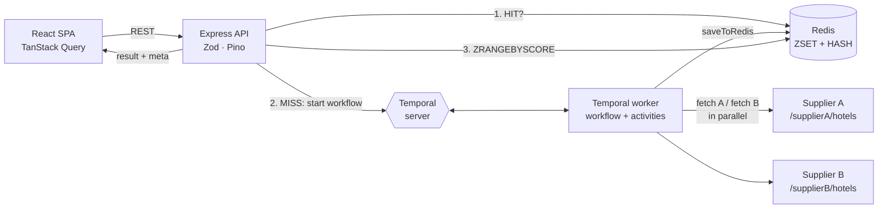

# StaySync – Hotel Offer Orchestrator

StaySync compares hotel offers from two independent (mocked) suppliers, **orchestrated by a Temporal workflow**, cached in **Redis**, served by an **Express/TypeScript** API and explored through a **React** dashboard.

For every hotel it keeps the **cheapest valid offer**, remembers every competing offer, tells you how much you save, and keeps serving when a supplier fails.

- [Features](#features) · [Architecture](#architecture) · [Quick start (Docker)](#quick-start-docker) · [Local development](#local-development) · [API](#api-documentation) · [Temporal](#temporal-workflow) · [Redis](#redis-implementation) · [Testing](#testing) · [Deployment](#deployment) · [Limitations](#limitations)

## Features

| Area | What you get |
| --- | --- |
| Orchestration | `hotelOfferWorkflow`: Supplier A + B fetched **concurrently**, per-activity timeouts, exponential-backoff retries, independent failure handling, then normalize → aggregate → save to Redis (each a separate activity) |
| Deduplication | Name normalisation (case, whitespace, punctuation, `&`, diacritics, leading "The"), cheapest valid price wins, deterministic tie-break, all competing offers kept |
| Redis | Per-city sorted set (`ZRANGEBYSCORE` price filtering **inside Redis**), details hash, TTL, atomic refresh with no stale members, `X-Cache: HIT/MISS` |
| Resilience | One supplier down → degraded-but-served result (`meta.degraded`); both down → `502 ALL_SUPPLIERS_FAILED` with per-supplier status |
| API | Search, price/rating/supplier/name filters, sorting, refresh, per-hotel offer comparison, health, metrics, workflow history, analytics |
| UI | Overview dashboard, hotel search (cards + Leaflet map), offer comparison modal, supplier monitoring with dev-only failure simulation, workflow timeline, analytics |
| Integrations (all optional, with fallbacks) | OpenWeather, Geoapify, Frankfurter currency (display-only), Leaflet/OpenStreetMap |

## Architecture



Request flow for `GET /api/hotels?city=delhi&minPrice=3000&maxPrice=8000`:

1. API validates the query (Zod) and checks `hotels:delhi` in Redis.
2. **Cache miss (or `refresh=true`)** → the API starts `hotelOfferWorkflow` with a unique workflow ID (`hotel-offers-<city>-<uuid>`) and **waits for the result**. Concurrent misses for the same city share one workflow (single-flight).
3. The worker runs the workflow: both supplier activities in parallel → `normalizeOffers` → `aggregateOffers` → `saveToRedis`. An optional `enrichCity` activity (geocoding) runs alongside the suppliers.
4. The API reads the price range from Redis (`ZRANGEBYSCORE`), applies the remaining filters/sorting, and responds with `data` + `meta`.

### Folder structure

```
staysync/
├── apps/
│   ├── backend/
│   │   ├── src/
│   │   │   ├── app.ts / server.ts / worker.ts / container.ts   # Express app, API entry, worker entry, composition root
│   │   │   ├── config/        # env (Zod), supported cities
│   │   │   ├── routes/ controllers/ middleware/ schemas/       # HTTP layer
│   │   │   ├── services/      # offers (pure dedupe logic), hotelSearch, telemetry, health, analytics, external APIs
│   │   │   ├── workflows/     # deterministic Temporal workflow (no I/O)
│   │   │   ├── activities/    # all I/O: supplier HTTP, Redis, geocoding
│   │   │   ├── temporal/      # client (starts workflows) + worker factory
│   │   │   ├── suppliers/     # independent mock supplier APIs + latency/error/outage simulation
│   │   │   ├── cache/         # Redis client + HotelCache (sorted-set layout)
│   │   │   └── types/ utils/
│   │   ├── tests/             # Vitest (unit, API, real-Temporal workflow + end-to-end)
│   │   ├── scripts/           # dev-temporal.ts, verify-stack.ts
│   │   └── Dockerfile
│   └── frontend/
│       ├── src/{pages,components,charts,hooks,services,layouts,utils,types}
│       ├── nginx.conf
│       └── Dockerfile
├── docker-compose.yml
├── .env.example
├── postman/                   # collection + environment
└── README.md
```

### Frontend routes

`/` landing page · `/search` hotel search (accepts `?city=&minPrice=&maxPrice=&q=`) · `/dashboard` · `/suppliers` · `/workflows` · `/analytics`. The landing page's "Sign in" link opens the dashboard (the demo has no accounts). Photography is from Unsplash (credited in the footer).

## Prerequisites

- **Docker + Docker Compose** (recommended path), or
- Node.js ≥ 20 (22 used in the Dockerfiles), npm ≥ 10, and a Redis server for local development.

## Quick start (Docker)

```bash
cp .env.example .env        # optional: add OPENWEATHER_API_KEY / GEOAPIFY_API_KEY
docker compose up --build
```

| Service | URL |
| --- | --- |
| Frontend | http://localhost:3000 |
| API | http://localhost:4000 (`/health`, `/api/...`) |
| Temporal UI | http://localhost:8080 |
| Temporal gRPC | `localhost:7233` |
| Redis | `localhost:6379` |

Services: `frontend` (nginx), `backend` (API + mock suppliers), `worker` (Temporal worker), `redis`, `temporal` (dev server with SQLite in a named volume), `temporal-ui`. Backend and worker wait for healthy Redis/Temporal; containers talk to each other by service name (`redis`, `temporal`, `backend`).

> `VITE_API_BASE_URL` is baked into the frontend bundle **at build time** and must be a URL the *browser* can reach (default `http://localhost:4000`). Changing it requires `docker compose build frontend`.

## Local development

```bash
npm install

# 1. Redis (any Redis ≥ 5)
docker run --rm -p 6379:6379 redis:7-alpine

# 2. A local Temporal dev server on :7233 (no Docker needed; or use the Temporal CLI: `temporal server start-dev`)
npm run dev:temporal

# 3. API (+ mock suppliers) on :4000, worker, and frontend on :5173 — one terminal each
npm run dev:backend
npm run dev:worker
cp apps/frontend/.env.example apps/frontend/.env   # VITE_API_BASE_URL=http://localhost:4000
npm run dev:frontend
```

Defaults point at `localhost` for Redis/Temporal/suppliers, so no backend `.env` is needed. Production-style run: `npm run build -w apps/backend && npm run start -w apps/backend` (and `start:worker`).

### Environment variables

See [`.env.example`](.env.example) (complete list). Highlights:

| Variable | Default | Purpose |
| --- | --- | --- |
| `REDIS_URL` | `redis://localhost:6379` | Redis connection |
| `CACHE_TTL_SECONDS` | `300` | TTL of aggregated data (5 min). Degraded results use `DEGRADED_CACHE_TTL_SECONDS` (30) so recovery is quick |
| `TEMPORAL_ADDRESS` / `TEMPORAL_NAMESPACE` / `TEMPORAL_TASK_QUEUE` | `localhost:7233` / `default` / `hotel-offers` | Temporal connection |
| `SUPPLIER_A_URL` / `SUPPLIER_B_URL` | `http://localhost:4000/supplierX` | Where activities call suppliers (swap for real suppliers) |
| `SUPPLIER_TIMEOUT_MS`, `SUPPLIER_RETRY_INITIAL_MS`, `SUPPLIER_RETRY_BACKOFF`, `SUPPLIER_RETRY_MAX_ATTEMPTS` | `4000`, `500`, `2`, `3` | Activity timeout & retry policy |
| `SUPPLIER_{A,B}_ENABLED / LATENCY_MS / ERROR_RATE` | `true / 250,550 / 0` | Initial mock-supplier behaviour |
| `ENABLE_DEV_ENDPOINTS` | `true` unless `NODE_ENV=production` | Supplier-failure simulation endpoints |
| `OPENWEATHER_API_KEY`, `GEOAPIFY_API_KEY` | empty | Optional integrations (graceful fallback when empty) |
| `VITE_API_BASE_URL` | `http://localhost:4000` | Frontend → API URL |

## API documentation

All hotel prices are **INR per night, supplier rates**. Errors share one shape: `{ "error": { "code", "message", "details?" }, "meta?" }`.

### `GET /api/hotels`

| Param | Description |
| --- | --- |
| `city` (required) | Case-insensitive; normalised (`Delhi` → `delhi`). Supported: delhi, mumbai, bangalore, jaipur, goa, hyderabad. Other cities return an empty result |
| `minPrice`, `maxPrice` | Inclusive range, each optional. `400` if not a non-negative number or `minPrice > maxPrice` |
| `sortBy` | `price` (default) · `rating` · `commission` |
| `sortOrder` | `asc` (default) · `desc` |
| `supplier` | `Supplier A` / `Supplier B` – filters by the **winning** supplier |
| `minRating`, `q` | Minimum rating (0–5), hotel-name search |
| `refresh=true` | Bypass the cache and re-run the workflow |

Headers: `X-Cache: HIT|MISS`, `X-Workflow-Id`, `X-Request-Id`.

```jsonc
// GET /api/hotels?city=delhi&minPrice=5000&maxPrice=6500
{
  "data": [
    {
      "hotelId": "b1", "slug": "grand palace", "name": "The Grand Palace", "city": "delhi",
      "price": 5900, "supplier": "Supplier B", "commissionPct": 18, "rating": 4.5,
      "latitude": 28.6139, "longitude": 77.209,
      "originalPrice": 6500, "savings": 600, "priceDifference": 600, "competingOffers": 2,
      "description": "…", "lastUpdated": "2026-11-22T06:12:50.071Z"
    }
  ],
  "meta": {
    "city": "delhi", "totalHotels": 7, "filteredHotels": 3, "minPrice": 5000, "maxPrice": 6500,
    "cache": "HIT", "refreshed": false, "workflowId": "hotel-offers-delhi-0e76a8de-…",
    "degraded": false, "supplierStatus": { "supplierA": "success", "supplierB": "success" },
    "lastUpdated": "…", "cacheTtlSeconds": 287, "cityInfo": { "latitude": 28.6139, "longitude": 77.209, "source": "builtin" },
    "timestamp": "…"
  }
}
```

Degraded: `meta.degraded: true`, `meta.supplierStatus: { "supplierA": "failed", "supplierB": "success" }` and `data` contains only the surviving supplier's hotels. Both suppliers down → `502`:
`{ "error": { "code": "ALL_SUPPLIERS_FAILED", … }, "meta": { "degraded": true, "supplierStatus": { "supplierA": "failed", "supplierB": "failed" }, "workflowId": "…" } }`.

### `GET /api/hotels/:hotelName/offers?city=delhi`

Every supplier offer for one hotel (name matched after normalisation, so `the grand palace` works).

```json
{
  "hotel": "The Grand Palace", "city": "delhi",
  "offers": [
    { "supplier": "Supplier B", "hotelId": "b1", "price": 5900, "commissionPct": 18, "rating": 4.5, "priceDifference": 0, "isBest": true },
    { "supplier": "Supplier A", "hotelId": "a1", "price": 6500, "commissionPct": 12, "rating": 4.5, "priceDifference": 600, "isBest": false }
  ],
  "bestOffer": { "supplier": "Supplier B", "price": 5900, "commissionPct": 18 },
  "savings": 600
}
```

### Other endpoints

| Endpoint | Description |
| --- | --- |
| `GET /supplierA/hotels?city=` · `GET /supplierB/hotels?city=` | Mock suppliers (`/health` too). Simulated latency, `503` when disabled, `500` at the configured error rate |
| `GET /health` | `{ status: healthy\|degraded\|unhealthy, timestamp, services: { api, redis, temporal, supplierA, supplierB } }`. Supplier down → `degraded` (200); Redis/Temporal down → `unhealthy` (503). Live probes, nothing cached |
| `GET /api/metrics` | Requests, cache hits/misses/ratio, workflow executions/failures, supplier failures, avg supplier response time, avg workflow duration, hotels aggregated, last refresh, per-supplier stats. Contains no secrets |
| `GET /api/workflows` | Recent workflow executions with per-step timings/attempts (recorded from real workflow results) |
| `GET /api/suppliers` · `GET /api/recent-searches` · `GET /api/analytics` · `GET /api/cities` | Dashboard data |
| `GET /api/weather?city=` | OpenWeather: `{ available, temperatureC, condition, icon, humidity }` or `{ available: false, reason }` |
| `GET /api/geocode?city=` | Geoapify coordinates, falling back to a built-in table for the supported cities |
| `GET /api/currency` | INR → USD/EUR/GBP rates from Frankfurter (cached 1h). Used for **display only** |
| `POST /api/dev/suppliers/:supplierA\|supplierB` `{ enabled?, latencyMs?, errorRate? }` · `POST /api/dev/suppliers/reset` | Failure simulation. Disabled when `ENABLE_DEV_ENDPOINTS=false` (default in production) |

## Temporal workflow

`hotelOfferWorkflow(input)` (`apps/backend/src/workflows/hotelOffer.workflow.ts`):

1. Start **Supplier A**, **Supplier B** and (optional) **city enrichment** concurrently with `Promise.all`. Each supplier call is wrapped so a failure becomes a result instead of rejecting the group → suppliers fail independently.
2. Supplier activities: `startToCloseTimeout = SUPPLIER_TIMEOUT_MS + 500ms`, retry policy `initialInterval=500ms, backoffCoefficient=2, maximumAttempts=3` (all configurable, never infinite). HTTP 4xx and malformed payloads are non-retryable.
3. Both failed → the workflow throws `ApplicationFailure.nonRetryable('ALL_SUPPLIERS_FAILED', …details)`; the API maps it to `502`.
4. `normalizeOffers` (validate, reject invalid prices, clean names/coordinates) → `aggregateOffers` (group by normalised name, pick cheapest, compute savings) → `saveToRedis`.
5. The result carries step timings, attempts, per-supplier status and cache metadata (the hotel list itself goes straight to Redis, not through workflow history).

Determinism: the workflow contains **no HTTP, Redis, `Math.random` or `process.env`**; configuration arrives via the input, and every I/O call is an activity (`fetchSupplierA`, `fetchSupplierB`, `normalizeOffers`, `aggregateOffers`, `saveToRedis`, `enrichCity`). The worker (`src/worker.ts`) registers the workflow and all activities. Inspect executions in the Temporal UI (http://localhost:8080) or on the app's **Workflows** page.

**Deduplication rules** (`src/utils/normalize.ts`, `src/services/offers.ts`): lowercase, strip diacritics, `&`→`and`, drop punctuation, collapse whitespace, drop a leading "the" (word order is never changed). Invalid prices (≤0, `NaN`, non-numeric) are rejected. Equal prices are tie-broken by **higher commission, then supplier name** – deterministic regardless of arrival order.

## Redis implementation

Per normalised city:

| Key | Type | Content |
| --- | --- | --- |
| `hotels:<city>` | string (JSON) | Cache metadata; its existence means "warm". TTL = `CACHE_TTL_SECONDS` |
| `hotel_prices:<city>` | sorted set | member = hotel slug, **score = cheapest price** |
| `hotel_details:<city>` | hash | slug → JSON hotel (including all competing offers) |

- **Price filtering** is `ZRANGEBYSCORE hotel_prices:<city> <min|-inf> <max|+inf>` followed by `HMGET` for the returned slugs – the range selection happens in Redis, not in Express.
- **Refresh without stale entries**: `DEL` + `ZADD` + `HSET` + `EXPIRE` run in a single `MULTI/EXEC`, so readers never see a half-written city and members from the previous dataset cannot survive (covered by tests).
- Supplier/rating/name filtering and sorting are applied in Express on the (already price-filtered) result.
- Metrics, workflow history and recent searches also live in Redis (survive API restarts).

## Supplier failure handling

- Retries and timeouts live in Temporal (see above). After retries are exhausted that supplier is marked `failed`; the other supplier's hotels are still aggregated, cached (30 s TTL) and served with `meta.degraded=true`.
- Try it in the UI: **Suppliers → Failure simulation** (clearly labelled DEV ONLY) or `POST /api/dev/suppliers/supplierA {"enabled": false}`, then refresh a city. Set `SUPPLIER_A_ENABLED=false` / `SUPPLIER_B_ERROR_RATE=0.5` to start that way.

## Testing

```bash
npm test                      # backend (Vitest) + frontend
npm run typecheck
npm test -w apps/backend      # 55 tests
```

Backend suites: name normalisation, deduplication/cheapest/tie/invalid-price/single-supplier logic, mock supplier endpoints, Redis cache + sorted-set filtering + stale-entry removal, API (hit/miss/refresh/validation/filters/sorting/offers/metrics/degraded/both-failed), health (healthy/degraded/unhealthy), and **two suites that run the real workflow on a real Temporal dev server** (downloaded automatically by `@temporalio/testing`): `workflow.test.ts` (concurrency, retries, degradation, total failure) and `e2e.test.ts` (HTTP → Express → Temporal client → worker → suppliers → Redis → HTTP). Redis is an in-memory mock (`ioredis-mock`) in tests. The first run downloads the Temporal test server binary, so it needs internet access.

## Postman

1. Postman → **Import** → select `postman/StaySync.postman_collection.json` and `postman/StaySync.postman_environment.json`.
2. Choose the **StaySync Local** environment (variables `baseUrl`, `city`, `minPrice`, `maxPrice`).
3. Run the collection (requests include assertions). CLI: `npx newman run postman/StaySync.postman_collection.json -e postman/StaySync.postman_environment.json`.

Folder 17 disables suppliers: with both disabled request 17c returns `502`; run 17d to restore.

## Screenshots

_Not included yet._ Run the app and capture: Overview (`/`), Hotel Search (`/search`, list and map views), the offers comparison modal, Suppliers, Workflows (timeline) and Analytics; add them under `docs/screenshots/` and link them here.

## Deployment

The project is container-first and platform-agnostic (Railway, Render, Fly.io, a VPS). Deploy **frontend**, **backend (API)**, **worker**, **Redis** and **Temporal** as separate long-running services.

- **Temporal must be a persistent, long-running service – it cannot run as a serverless function.** The workers keep long-polling connections open. Use Temporal Cloud (recommended) or a self-hosted cluster (Postgres/MySQL-backed). The `temporalio/temporal` dev server in `docker-compose.yml` is for development only.
- Backend and worker use the **same image** (`apps/backend/Dockerfile`); start the worker with `node dist/worker.js`. Scale workers independently.
- Externalise configuration: `REDIS_URL`, `TEMPORAL_ADDRESS`, `TEMPORAL_NAMESPACE` (+ TLS/API key settings if you use Temporal Cloud – extend `temporal/client.ts` and `temporal/worker.ts`), `SUPPLIER_*_URL`, `CORS_ORIGIN`, API keys. Use the platform's secret store; never commit `.env`.
- Set `NODE_ENV=production` (disables dev simulation endpoints) and `CORS_ORIGIN` to the frontend's origin.
- Build the frontend with `--build-arg VITE_API_BASE_URL=https://api.example.com`, or `npm run build -w apps/frontend` with that env var, and serve `apps/frontend/dist` from any static host.
- The mock suppliers are mounted in the API process. For a real deployment point `SUPPLIER_A_URL`/`SUPPLIER_B_URL` at the real services; in that case the simulation endpoints no longer affect them.
- Don't publish Redis/Temporal ports in production: remove the `ports:` entries of `redis`, `temporal`, `temporal-ui` from the compose file (or use the platform's private network).

## Limitations

- Suppliers are **mocked** and live inside the API process; the failure simulator only affects those mocks.
- Prices are per night in INR; no dates, occupancy or availability. Currency conversion is display-only.
- Cache-hit metrics count `/api/hotels` requests; a `refresh=true` request counts as a miss. Workflow history shows executions recorded by this API (not a full Temporal visibility query), capped at the latest 100.
- Analytics loads every supported city; the first call on a cold cache triggers one workflow per city.
- The Docker Compose setup, and the `npm ci -w` production image build, were written but **could not be executed on the authoring machine** (no Docker available) – see the verification notes in the hand-off summary.
- Hotel photos are stock Unsplash images chosen per hotel (gradient fallback if they fail to load).
- Temporal dev-server persistence is SQLite in a volume; not for production.

## Future improvements

Date/occupancy-aware search, per-supplier circuit breakers, Temporal visibility queries for the workflow page, scheduled background refreshes (Temporal schedules), auth + rate limiting, OpenTelemetry tracing, route-level code splitting for the SPA, Playwright UI tests.
# Tripare_AI

